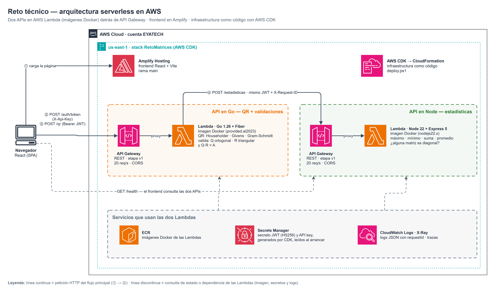
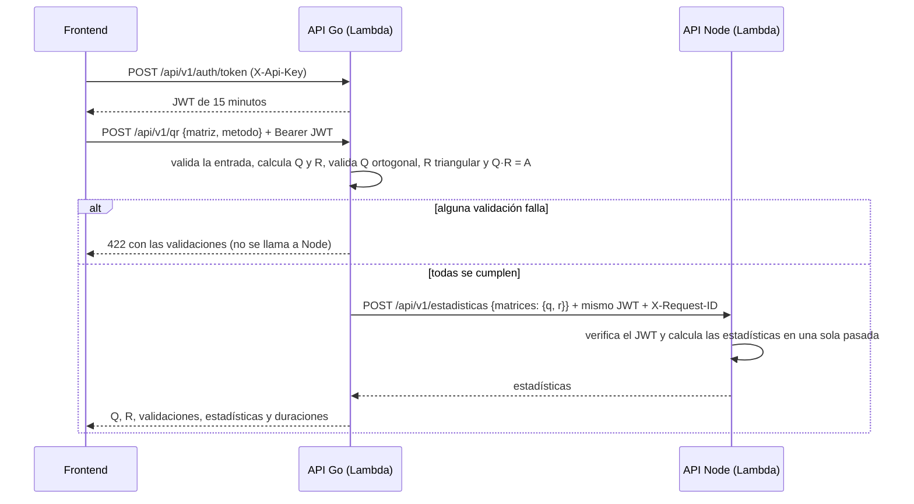

# Reto técnico — Factorización QR (Go) y estadísticas (Node.js)

Dos APIs REST **serverless** que se comunican por HTTP:

- **API en Go (Fiber):** recibe una matriz rectangular, calcula su **factorización QR**, valida que **Q sea ortogonal** y **R triangular superior**, y envía Q y R a la API en Node.
- **API en Node.js (Express):** recibe las matrices y calcula **máximo, mínimo, promedio, suma total** y **si alguna es diagonal**.

También se implementó la funcionalidad opcional: frontend en React (AWS Amplify), seguridad con JWT y pruebas unitarias y de integración.

| Servicio desplegado | URL |
|---|---|
| Frontend | https://main.d3gte9i6ei4eac.amplifyapp.com |
| API en Go | https://s7lpc2bodl.execute-api.us-east-1.amazonaws.com/v1 |
| API en Node | https://skaigmqxna.execute-api.us-east-1.amazonaws.com/v1 |

### Cumplimiento del enunciado

| Requisito | Dónde se cumple |
|---|---|
| API en Go con Fiber y API en Node.js con Express | `api-go/`, `api-node/` |
| La API en Go recibe un array de arrays y devuelve la QR | `POST /api/v1/qr` |
| La API en Go envía el resultado a la API en Node por HTTP | `api-go/internal/estadisticas/cliente.go` |
| Máximo, mínimo, promedio, suma total y "¿alguna matriz es diagonal?" | `api-node/src/domain/estadisticas.js` |
| Docker | `Dockerfile` en cada API (imagen local y de Lambda) y `docker-compose.yml` |
| Servicios en la nube | AWS: Lambda, API Gateway, Secrets Manager, ECR, Amplify y CloudWatch, con CDK |
| Documentación | Este README, comentarios en el código y `notebooks/QR_y_autovalores.ipynb` |
| *Opcional:* frontend que consuma ambas APIs | `frontend/`, publicado en Amplify |
| *Opcional:* JWT | `POST /api/v1/auth/token`; las dos APIs verifican el token |
| *Opcional:* pruebas unitarias y de integración | `go test`, `npm test` y `scripts/prueba-humo.mjs` |

---

## 1. Arquitectura serverless

El back no tiene servidores que administrar. Cada API es una **función Lambda** empaquetada como **imagen Docker** y expuesta con su propio **API Gateway**:
- se ejecuta solo cuando llega una petición;
- escala sola;
- cuesta prácticamente cero cuando no se usa.

Los secretos se generan en **Secrets Manager**, los logs y las trazas van a **CloudWatch** y **X-Ray**, y toda la infraestructura se describe como código con **AWS CDK**.



> Diagrama editable en draw.io: [`docs/arquitectura.drawio`](docs/arquitectura.drawio). Se genera con `python docs/diagrama_arquitectura.py`.

### Componentes en AWS

| Recurso | Nombre | Para qué |
|---|---|---|
| Lambda (imagen Docker, `provided.al2023`) | `reto-matrices-api-go` | QR, validaciones y orquestación. 512 MB, timeout de 20 s |
| Lambda (imagen Docker, `nodejs22.x`) | `reto-matrices-api-node` | Estadísticas. 256 MB, timeout de 10 s |
| API Gateway REST, etapa `v1` | `reto-matrices-api-go`, `reto-matrices-api-node` | Entrada HTTPS, CORS y límite de 20 peticiones por segundo (ráfagas de 40) |
| Secrets Manager | `reto-matrices/jwt-secret`, `reto-matrices/api-key` | Secretos generados en el despliegue; nadie los escribe a mano |
| ECR | repositorio de assets de CDK | Imágenes de las dos Lambdas |
| CloudWatch Logs y X-Ray | `/aws/lambda/reto-matrices-*` | Logs JSON con `requestId`, retención de 7 días y trazas |
| Amplify Hosting | `reto-matrices`, rama `main` | Frontend estático |

Todo está en el stack `RetoMatrices` (`infra/`), cuenta EYATECH, región `us-east-1`.

### Recorrido de una petición



El `X-Request-ID` es el mismo en las dos APIs. Por ejemplo, en CloudWatch:

```
reto-matrices-api-go   {"requestId":"40c658e0-…","ruta":"/api/v1/qr","estado":200}
reto-matrices-api-node {"requestId":"40c658e0-…","ruta":"/api/v1/estadisticas","estado":200}
```

### Arquitectura interna: hexagonal (puertos y adaptadores)

El dominio de cada API no sabe nada de HTTP ni de AWS. Así se prueba sin levantar servidores, y **el mismo código corre en Docker o en Lambda**: solo cambia el punto de entrada.

| Capa | API en Go | API en Node |
|---|---|---|
| Dominio | `internal/matriz`: validación, 4 métodos de QR (Strategy), validaciones y autovalores | `src/domain/estadisticas.js` |
| Puerto de salida | `internal/estadisticas.Cliente` (interfaz) | — |
| Adaptador de salida | `internal/estadisticas.ClienteHTTP`: timeout, reintento y reenvío del token | — |
| Adaptador de entrada HTTP | `internal/httpapi` (Fiber) | `src/app.js` (Express 5) |
| Seguridad | `internal/auth`: emite y verifica el JWT | `src/auth.js`: verifica el JWT |
| Configuración | `internal/config`: variables de entorno o Secrets Manager | `src/config.js` |
| Punto de entrada | `cmd/api/main.go`: servidor HTTP, o Lambda si existe `AWS_LAMBDA_RUNTIME_API` | `src/server.js` (Docker) y `src/lambda.js` (Lambda) |

### Estructura del repositorio

```
api-go/        API en Go (Fiber) + Dockerfile con etapas `local` y `lambda`
api-node/      API en Node (Express 5, ES modules) + Dockerfile con etapas `local` y `lambda`
frontend/      React + Vite
infra/         AWS CDK en Python (stack RetoMatrices)
notebooks/     Prototipo en Python: los 4 métodos a mano, verificados contra NumPy
scripts/       prueba-humo.mjs: prueba de punta a punta (local o AWS)
deploy.ps1     Pruebas → CDK → frontend en Amplify → prueba de humo
docs/          Diagrama de arquitectura (draw.io y PNG)
docker-compose.yml
```

---

## 2. Diccionario de datos

### 2.1 Endpoints

| API | Método y ruta | Autenticación | Descripción |
|---|---|---|---|
| Go | `GET /health` | — | Estado del servicio |
| Go | `POST /api/v1/auth/token` | `X-Api-Key` | Entrega un JWT válido por 15 minutos |
| Go | `POST /api/v1/qr` | Bearer JWT | Factorización QR, validaciones y estadísticas |
| Go | `POST /api/v1/autovalores` | Bearer JWT | Extra: autovalores y autovectores de una matriz simétrica |
| Node | `GET /health` | — | Estado del servicio |
| Node | `POST /api/v1/estadisticas` | Bearer JWT | Estadísticas de un conjunto de matrices |

En AWS, las rutas van después de la etapa: `https://…/v1/api/v1/qr`.

### 2.2 Encabezados HTTP

| Encabezado | Dirección | Tipo | Descripción |
|---|---|---|---|
| `Content-Type` | petición | `application/json` | Cuerpo en JSON |
| `X-Api-Key` | petición | string (32 caracteres) | Solo en `/auth/token`. Clave guardada en `reto-matrices/api-key` |
| `Authorization` | petición | `Bearer <JWT>` | Obligatorio en `/qr`, `/autovalores` y `/estadisticas`. Go reenvía el mismo valor a Node |
| `X-Request-ID` | petición y respuesta | string (UUID) | Identificador de la petición. Si no se envía, la API lo genera; Go lo reenvía a Node |
| `WWW-Authenticate` | respuesta | string | En las respuestas 401: `Bearer realm="reto-matrices"` |

### 2.3 `POST /api/v1/auth/token` (Go)

**Respuesta 200**

| Campo | Tipo | Descripción |
|---|---|---|
| `accessToken` | string | JWT firmado con HS256 |
| `tokenType` | string | Siempre `"Bearer"` |
| `expiresIn` | entero | Segundos de vigencia: `900` |

**Claims del JWT**

| Claim | Valor | Verificación |
|---|---|---|
| `iss` | `reto-matrices` | Go y Node rechazan otro emisor |
| `aud` | `reto-matrices-apis` | Go y Node rechazan otra audiencia |
| `sub` | `frontend` | Quién pidió el token |
| `iat` / `exp` | fecha Unix | `exp` = `iat` + 15 min; es obligatorio y se rechaza si venció |
| algoritmo | `HS256` | Solo se acepta HS256; `alg: none` u otros se rechazan |

### 2.4 `POST /api/v1/qr` (Go)

**Petición**

| Campo | Tipo | Obligatorio | Restricciones | Descripción |
|---|---|---|---|---|
| `matriz` | `number[][]` | sí | No vacía, rectangular (todas las filas del mismo largo), solo números finitos (no `null`, texto ni booleanos), máximo 200×200 | Matriz A de m filas y n columnas |
| `metodo` | string | no | `householder` (por defecto), `givens`, `gram-schmidt-modificado`, `gram-schmidt-clasico`. Gram-Schmidt exige m ≥ n y columnas independientes | Algoritmo de la QR |

```json
{ "matriz": [[1, 2], [3, 4], [5, 6]], "metodo": "householder" }
```

**Respuesta 200**

| Campo | Tipo | Descripción |
|---|---|---|
| `metodo` | string | Método usado |
| `dimensiones.filas` | entero | m |
| `dimensiones.columnas` | entero | n |
| `q` | `number[][]` | Q ortogonal: m×m con Householder y Givens (QR completa), m×n con Gram-Schmidt (QR reducida) |
| `r` | `number[][]` | R triangular superior: m×n (completa) o n×n (reducida), con la diagonal ≥ 0 |
| `validaciones` | objeto `Validaciones` | Las tres reglas que cumple la factorización (2.5) |
| `estadisticas` | objeto `Estadisticas` | Respuesta de la API en Node (2.7) |
| `duracionMs.qr` | número | Milisegundos para calcular y validar la QR |
| `duracionMs.estadisticas` | número | Milisegundos de la llamada a la API en Node |

```json
{
  "metodo": "householder",
  "dimensiones": { "filas": 3, "columnas": 2 },
  "q": [[0.1690, 0.8971, 0.4082], [0.5071, 0.2760, -0.8165], [0.8452, -0.3450, 0.4082]],
  "r": [[5.9161, 7.4374], [0, 0.8281], [0, 0]],
  "validaciones": {
    "qOrtogonal":     { "cumple": true, "error": 2.2e-16 },
    "rTriangular":    { "cumple": true, "error": 0 },
    "reconstruccion": { "cumple": true, "error": 1.5e-16 }
  },
  "estadisticas": {
    "maximo": 7.4374, "minimo": -0.8165, "suma": 16.5309, "promedio": 1.1021,
    "cantidadValores": 15, "esDiagonal": { "q": false, "r": false }, "algunaDiagonal": false
  },
  "duracionMs": { "qr": 0.02, "estadisticas": 3.1 }
}
```

### 2.5 Objeto `Validaciones`

Cada regla es `{ "cumple": boolean, "error": number }`. Se cumple si `error ≤ 1e-10`.

| Regla | Qué verifica | Cómo se mide `error` |
|---|---|---|
| `qOrtogonal` | QᵀQ = I: las columnas de Q tienen largo 1 y son perpendiculares | Mayor \|(QᵀQ)ᵢⱼ − Iᵢⱼ\| |
| `rTriangular` | Todo lo que está debajo de la diagonal de R es 0 | Mayor \|Rᵢⱼ\| con i > j |
| `reconstruccion` | Q·R = A | Mayor \|(QR)ᵢⱼ − Aᵢⱼ\| dividido entre max(1, max \|Aᵢⱼ\|) |

### 2.6 `POST /api/v1/autovalores` (Go)

**Petición:** `{ "matriz": number[][] }`, cuadrada y **simétrica**, con las mismas restricciones de `/qr`.

| Campo de la respuesta | Tipo | Descripción |
|---|---|---|
| `autovalores` | `number[]` | Autovalores de mayor a menor |
| `autovectores` | `number[][]` | Matriz n×n; la columna j es el autovector del autovalor j |
| `iteraciones` | entero | Iteraciones del algoritmo QR hasta converger (máximo 10 000) |

### 2.7 `POST /api/v1/estadisticas` (Node)

**Petición**

| Campo | Tipo | Obligatorio | Restricciones | Descripción |
|---|---|---|---|---|
| `matrices` | objeto `{ nombre: number[][] }` | sí | Al menos una matriz; cada una no vacía, rectangular y con números finitos; máximo 100 000 valores en total | Matrices a analizar. La API en Go envía `{ "q": …, "r": … }` |

**Respuesta 200 — objeto `Estadisticas`**

| Campo | Tipo | Descripción |
|---|---|---|
| `maximo` | número | Mayor valor de todas las matrices |
| `minimo` | número | Menor valor de todas las matrices |
| `suma` | número | Suma de todos los valores (suma compensada de Neumaier) |
| `promedio` | número | `suma / cantidadValores` |
| `cantidadValores` | entero | Cantidad total de valores |
| `esDiagonal` | objeto `{ nombre: boolean }` | Si cada matriz es diagonal: todo lo que está fuera de la diagonal principal es 0, con tolerancia 1e-10. Vale también para matrices no cuadradas |
| `algunaDiagonal` | boolean | `true` si al menos una matriz es diagonal |

### 2.8 `GET /health` (ambas)

| Campo | Tipo | Descripción |
|---|---|---|
| `estado` | string | `"ok"` |
| `servicio` | string | `"api-go"` o `"api-node"` |
| `version` | string | Fecha y hora del despliegue (`AAAAMMDD-HHMM`) o `dev` |

### 2.9 Errores (RFC 7807, `application/problem+json`)

Las dos APIs usan el mismo formato:

| Campo | Tipo | Descripción |
|---|---|---|
| `type` | string | `"about:blank"` |
| `title` | string | Resumen del error |
| `status` | entero | Código HTTP |
| `detail` | string | Explicación concreta, por ejemplo: `"La fila 1 tiene 1 elementos y la fila 0 tiene 2: la matriz no es rectangular"` |
| `requestId` | string | El `X-Request-ID` de la petición |
| `extra` | objeto | Solo en los 422: `{ "metodo", "validaciones" }` |

| Código | Cuándo |
|---|---|
| 400 | JSON inválido; matriz vacía, no rectangular, con valores no numéricos o mayor a 200×200; método desconocido; Gram-Schmidt con más columnas que filas o con columnas dependientes; matriz no simétrica en `/autovalores` |
| 401 | Falta el JWT, o es inválido o está vencido; API key incorrecta |
| 404 | Ruta inexistente |
| 413 | Cuerpo demasiado grande |
| 422 | La factorización **no cumple las validaciones** (por ejemplo, Gram-Schmidt clásico con Hilbert 10×10). No se llama a Node |
| 429 | API Gateway limitó la cantidad de peticiones |
| 502 | La API en Node no respondió correctamente |

### 2.10 Configuración: variables de entorno y secretos

| Variable | API | Local (`docker-compose.yml`) | AWS | Descripción |
|---|---|---|---|---|
| `NODE_API_URL` | Go | `http://api-node:3000` | URL del API Gateway de Node | Dónde está la API de estadísticas |
| `JWT_SECRET` | Go, Node | `.env` de la raíz | — | Secreto HS256 en local |
| `JWT_SECRET_ARN` | Go, Node | — | ARN de `reto-matrices/jwt-secret` | Secreto HS256 en AWS, leído al arrancar |
| `API_KEY` | Go | `.env` de la raíz | — | API key en local |
| `API_KEY_ARN` | Go | — | ARN de `reto-matrices/api-key` | API key en AWS |
| `PORT` | Go, Node | 8080 / 3000 | — (Lambda no escucha puertos) | Puerto del servidor HTTP |
| `VERSION` | Go, Node | `local` | fecha del despliegue | Se muestra en `/health` |
| `VITE_API_GO_URL`, `VITE_API_NODE_URL` | Frontend | `frontend/.env` | los escribe `deploy.ps1` | URLs de las APIs que se incluyen en el build |
| `VITE_API_KEY` | Frontend | `frontend/.env` | **no se usa** | API key para desarrollo local. El build publicado **no** la incluye: el usuario la ingresa en la página |
| `API_GO_URL`, `API_NODE_URL`, `API_KEY` | Prueba de humo | `.env` de la raíz | — | Destino y API key de `scripts/prueba-humo.mjs` |

Ningún secreto está en el código: los valores locales van en archivos `.env`, que git ignora, y cada carpeta trae un `.env.example` con las variables y sin valores secretos.

### 2.11 Constantes del dominio

| Constante | Valor | Dónde | Por qué |
|---|---|---|---|
| `Tolerancia` / `TOLERANCIA` | `1e-10` | Go y Node | Margen para decidir si un número de punto flotante es cero |
| `MaxDimension` | 200 | Go | Q y R de 200×200 suman unos 2 MB de JSON; Lambda responde hasta 6 MB |
| `MAX_VALORES` | 100 000 | Node | Q y R de 200×200 tienen 80 000 valores |
| `tolDependencia` | `1e-14` | Go | Por debajo de esto, Gram-Schmidt considera que una columna es dependiente |
| `MaxIteraciones` | 10 000 | Go | Tope del algoritmo QR de autovalores |
| Timeout del cliente Go → Node | 8 s | Go | Menor que el timeout de la Lambda (20 s) y el de API Gateway (29 s) |

---

## 3. Decisiones técnicas

### Presentación del caso

El reto pide dos APIs: una en Go que factorice una matriz y otra en Node que calcule estadísticas sobre el resultado, contenerizadas con Docker y desplegadas en la nube. Antes de escribir las APIs armamos un notebook en Python (`notebooks/QR_y_autovalores.ipynb`) con los cuatro métodos de QR programados a mano y verificados contra NumPy. Ese notebook sirvió de especificación: las funciones de Go tienen la misma lógica, y las pruebas de Go repiten sus tablas.

### Definición del problema central

El enunciado deja varias cosas abiertas, y la consigna pide "tomar decisiones informadas y sustentarlas":

- En una parte dice **"rotación de la matriz"** y en otra **"factorización QR"**.
- Dice "verificar si **alguna** matriz es diagonal", pero no define qué es diagonal en una matriz rectangular ni qué hacer con los residuos de redondeo.
- Pide **JWT**, pero no hay usuarios ni login.
- Pide **Docker** y **servicios en la nube**, y el despliegue debía ser serverless.

### Alternativas de solución

**Rotación o QR.** Implementamos la QR, porque es el requisito funcional explícito y porque produce *las matrices* (Q y R) de las que Node tiene que decir si "alguna es diagonal"; una rotación produce una sola matriz. Además, la QR se puede calcular **rotando** la matriz (método de Givens), que quedó como uno de los cuatro métodos. Así las dos lecturas del enunciado quedan cubiertas.

**Qué método de QR usar por defecto.** Comparamos los cuatro en el notebook con matrices fáciles y difíciles. El valor de cada celda es el error de ortogonalidad de Q:

| Matriz | Gram-Schmidt clásico | Gram-Schmidt modificado | Householder | Givens |
|---|---|---|---|---|
| Aleatoria 50×30 | ✅ 4e-16 | ✅ 4e-16 | ✅ 1e-15 | ✅ 2e-15 |
| Hilbert 6×6 | ❌ 2e-04 | ✅ 9e-11 | ✅ 7e-16 | ✅ 1e-15 |
| Hilbert 10×10 | ❌ 1e+00 | ❌ 5e-05 | ✅ 9e-16 | ✅ 7e-16 |
| Rango deficiente o ancha 2×3 | ⛔ no la acepta | ⛔ no la acepta | ✅ | ✅ |
| Tiempo con 200×200 (Python) | ~66 ms | ~57 ms | **~20 ms** | ~280 ms |

Gram-Schmidt es el que vimos en clase y el más fácil de explicar, pero pierde la ortogonalidad con matrices mal condicionadas y no acepta matrices anchas ni de rango deficiente. Givens es estable pero el más lento con matrices llenas. **Householder** es el más estable y el más rápido, y quedó como método por defecto. Los otros tres siguen disponibles con el campo `metodo`, implementados con el patrón Strategy.

**Validar el resultado, no solo la entrada.** Al principio pensamos revisar solo que Q·R = A. Pero eso no basta: Q = A y R = identidad también reconstruyen A, y Q no es ortogonal. Por eso cada respuesta trae las tres reglas: Q ortogonal, R triangular y Q·R = A. Si alguna falla, la API responde **422** y no llama a Node, para no calcular estadísticas sobre una factorización incorrecta.

**Qué es "diagonal".** Lo definimos como "todo lo que está fuera de la diagonal principal es cero", que también vale para matrices rectangulares como la R de una QR completa. Comparar con `== 0` falla: una R que en teoría es diagonal sale con residuos como `1e-17`. Por eso se usa la misma tolerancia de `1e-10` en las dos APIs.

**Dónde ejecutar las APIs.** El back tenía que ser serverless y además usar Docker:

| Alternativa | Docker | Costo sin tráfico | Cambios en el código | Arranque en frío | Elegida |
|---|---|---|---|---|---|
| **Lambda con imagen Docker + adaptador en el código** | ✅ el mismo Dockerfile genera la imagen local y la de Lambda | ~0 | Un punto de entrada que detecta Lambda | ~1.5-2.2 s (medido) | ✅ |
| Lambda con zip | ❌ | ~0 | Igual | algo menor | — |
| Lambda Web Adapter (la app sin cambios) | ✅ | ~0 | Ninguno | similar | — |
| ECS Fargate | ✅ | ~USD 10-15 al mes por servicio, siempre encendido | Ninguno | no hay | — |
| EC2 | ✅ | siempre encendido + parches del sistema operativo | Ninguno | no hay | — |

Elegimos Lambda con imagen Docker porque cumple los dos requisitos a la vez, y el adaptador en el código (`aws-lambda-go-api-proxy` en Go, `@codegenie/serverless-express` en Node) es la forma más común y documentada. Gracias a la arquitectura hexagonal, el adaptador es solo el punto de entrada: el dominio y los handlers no cambian.

**Cómo se comunican Go y Node.**

| Alternativa | Cumple "por HTTP" | Ventaja | Desventaja | Elegida |
|---|---|---|---|---|
| **HTTP a través del API Gateway de Node** | ✅ | Node también queda expuesta al frontend, igual que en local | Un salto más de red | ✅ |
| Invocar la Lambda de Node directo (SDK) | ❌ | Menor latencia | Acopla Go a AWS; en local no funciona igual | — |
| Cola SQS / EventBridge | ❌ | Desacopla y absorbe picos | El flujo es síncrono; el cliente espera la respuesta | — |

El cliente HTTP de Go tiene un timeout de 8 s (menor que el de la Lambda, 20 s, y el de API Gateway, 29 s) y **reintenta una vez** ante errores de red o 5xx. Reintentar es seguro porque calcular estadísticas no tiene efectos secundarios. Ante un 4xx no reintenta, porque repetir no lo arreglaría.

**Autenticación sin login.**

| Alternativa | Da un JWT | Funciona sin login | Complejidad | Elegida |
|---|---|---|---|---|
| Solo API key | ❌ | ✅ | baja | — |
| **JWT propio: API key → token de 15 min** | ✅ | ✅ | baja | ✅ |
| Cognito User Pool | ✅ | ❌ necesita usuarios | media | siguiente paso |
| Cognito Identity Pool (invitados) | ❌ usa firmas IAM | ✅ | media | — |
| Cognito *client credentials* | ✅ | ✅ | media | ❌ el secreto quedaría en el navegador |

Elegimos el JWT propio porque cumple el requisito y lo controlamos de punta a punta:
- la API key **no está en el código ni en el build publicado**: se entrega por correo, y quien la recibe la ingresa en la página (queda solo en esa pestaña) o la pone en su `.env` para probar en local;
- las dos APIs verifican firma, algoritmo, emisor, audiencia y caducidad;
- Go reenvía el mismo token a Node;
- API Gateway limita la cantidad de peticiones.

Con usuarios reales, el paso siguiente es Cognito con Amplify Auth.

**Dónde guardar los secretos.** Descartamos las variables de entorno con el valor en texto plano: quedan visibles en la consola de Lambda. Usamos **Secrets Manager**, con los secretos **generados por CDK** durante el despliegue. Cada Lambda los lee una vez al arrancar, y nadie los escribió ni los copió a mano.

**De `require()` a `import` en Node.** La API de Node empezó con `require()` (CommonJS). Funcionaba, pero el estándar del lenguaje es ES modules (`import`/`export`), y además ES modules permite `await` en el nivel superior del módulo. Eso importaba aquí: en CloudWatch vimos que la **primera** petición a Node tardaba **2.3 s**, porque leía el secreto del JWT en ese momento, y las siguientes tardaban 12-18 ms. Con ES modules, `lambda.js` hace `await obtenerSecretos()` al cargar el módulo, así que la lectura ocurre durante el arranque del contenedor y no en la primera petición.

**Tamaño máximo.** Q y R de 200×200 suman unos 2 MB de JSON, y la respuesta de una Lambda admite hasta 6 MB. Pusimos el límite en 200×200 con margen, y la API responde 400 con un mensaje claro si se supera.

### Recomendación final

La solución queda así:

- **Householder** como método por defecto, con las **tres validaciones** en cada respuesta y la **tolerancia** compartida por las dos APIs.
- Las dos APIs como **Lambdas en contenedor** detrás de API Gateway. El mismo Dockerfile corre en `docker compose` y en AWS.
- Comunicación por **HTTP** con timeout, reintento y `X-Request-ID`.
- Seguridad con un **JWT de corta duración** y secretos generados en Secrets Manager.

Este equilibrio cumple el enunciado y la parte opcional, sin agregar piezas que no se puedan defender en la entrevista.

### Limitaciones y siguientes pasos

- **Arranque en frío:** la primera petición después de un rato sin uso tarda 1.5-2.2 s (medido en CloudWatch). Las siguientes tardan 1-2 ms en Go y 12-18 ms en Node. Si importara, se puede usar *provisioned concurrency*.
- **Autovalores:** solo matrices simétricas y sin desplazamientos de Wilkinson. Si hay autovalores λ y −λ, el algoritmo no converge y responde 400.
- **La API key es compartida:** todos los que la reciben usan la misma, y no hay forma de saber quién hizo cada petición. Si se filtra, se cambia en Secrets Manager (`aws secretsmanager put-secret-value`) y se vuelve a desplegar. Con usuarios reales, cada uno tendría su propia sesión con Cognito.
- **CI/CD:** el despliegue es un script (`deploy.ps1`). El siguiente paso es GitHub Actions con las mismas etapas.

---

## 4. Cómo correrlo

### Con la API key recibida por correo (contra las APIs en AWS)

1. **Frontend en local:** copie `frontend/.env.example` como `frontend/.env` y pegue la key en `VITE_API_KEY`. Las URLs de AWS ya vienen puestas.
   ```bash
   cd frontend
   cp .env.example .env        # en Windows: copy .env.example .env
   npm install && npm run dev  # http://localhost:5173
   ```
2. **Prueba de humo:** copie `.env.example` como `.env` en la raíz y pegue la key en `API_KEY`.
   ```bash
   node --env-file=.env scripts/prueba-humo.mjs
   ```
3. **Sitio publicado:** abra https://main.d3gte9i6ei4eac.amplifyapp.com e ingrese la key en el campo "API key".

### Todo en local con Docker (sin AWS)

En `.env` de la raíz defina sus propios `API_KEY` y `JWT_SECRET`, y cambie las URLs a `http://localhost:8080` y `http://localhost:3000`. En `frontend/.env` use la Opción B, con la misma `API_KEY`.

```bash
docker compose up --build                       # Go en :8080, Node en :3000 (lee .env)
node --env-file=.env scripts/prueba-humo.mjs
cd frontend && npm install && npm run dev
```

### Pruebas

```bash
docker run --rm -v "$PWD/api-go:/src" -w /src golang:1.26-alpine go test ./...   # no requiere Go instalado
cd api-node && npm install && npm test
```

- **Go:**
  - la tabla de estabilidad del notebook: qué método cumple, falla o rechaza cada matriz;
  - los valores contra NumPy y la forma de Q y R;
  - las validaciones y los autovalores;
  - el handler HTTP con 200, 400, 401, 422 y 502;
  - el cliente hacia Node: reenvío del token, reintento ante 5xx y no ante 4xx.
- **Node:** estadísticas, tolerancia, suma de Neumaier, validación de la entrada y JWT (sin token, falso, vencido y con otra audiencia).
- **Integración:** `scripts/prueba-humo.mjs` corre 10 comprobaciones de punta a punta contra Docker o contra AWS.

### Despliegue en AWS

```powershell
.\deploy.ps1                 # perfil eyatech, región us-east-1 (Docker Desktop abierto)
.\deploy.ps1 -SoloFrontend   # vuelve a publicar solo el frontend
```

El script:
1. Corre las pruebas de Node.
2. Despliega el stack con CDK. Las imágenes se construyen con Docker, y el build de Go corre sus pruebas.
3. Construye y empaqueta el frontend con las URLs reales.
4. Lo publica en Amplify y comprueba que el sitio sirva ese mismo build.
5. Corre la prueba de humo contra AWS.

Para borrar todo: `cd infra; cdk destroy RetoMatrices --profile eyatech`.
